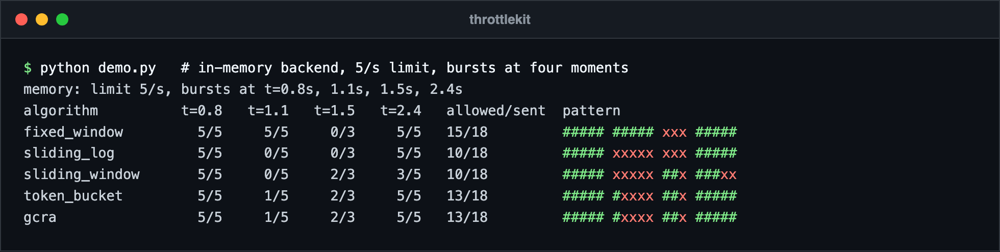
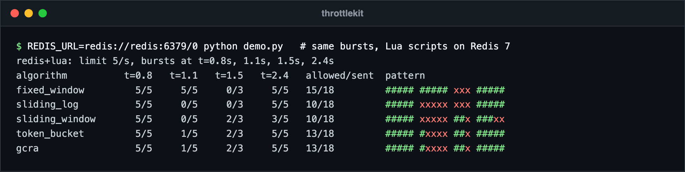
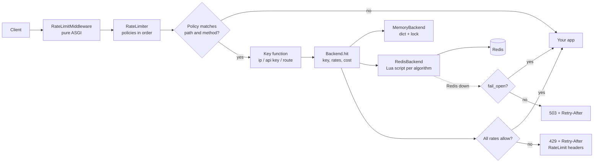

# throttlekit

   

Rate limiting for Python services. Five algorithms, an in-memory backend and an
atomic Redis backend (one Lua script per algorithm), declarative policies, and a
pure ASGI middleware for FastAPI and Starlette that answers `429` with
`Retry-After` and `RateLimit-*` headers.

## Screenshots

Each algorithm against the same traffic: a limit of 5 per second, with bursts of 5, 5, 3 and 5 requests at 0.8 s, 1.1 s, 1.5 s and 2.4 s. Green `#` is allowed, red `x` is denied. Fixed window lets 10 through across the boundary at 1.0 s. A manual clock drives time, so the run is repeatable. The demo script is a short loop over `backend.hit` and is not part of the repo.



The same run through the Lua scripts on a real Redis 7 container gives identical decisions to the in-memory Python code.



## Features

- **Algorithms:** fixed window, sliding window log, sliding window counter, token bucket, GCRA
- **Backends:** in-memory (single process) and Redis (shared, atomic via `register_script`)
- **Policies:** per route, per API key, per IP, or any composite key; several rates per key (`10/s` and `1000/h`)
- **Failure mode:** fail-open or fail-closed when Redis is unreachable
- **Testable:** injectable clock, no sleeps in the test suite; core package has no dependencies

## Algorithms

| Algorithm | Accuracy | State per key and rate | Burst behaviour |
|---|---|---|---|
| `fixed_window` | Approximate. Up to 2x the limit across a window boundary | O(1): window id and counter | Whole limit at any point in the window; double burst at the edge |
| `sliding_log` | Exact rolling window | O(limit): one timestamp per request | Whole limit at once, then each slot frees exactly one period after use |
| `sliding_window` | Close approximation; assumes the previous window's requests were spread evenly | O(1): two counters | Boundary burst smoothed by weighting the previous window |
| `token_bucket` | Exact for its model: average rate plus burst capacity | O(1): tokens and timestamp | Burst up to the limit, then refills continuously at `limit / period` |
| `gcra` | Exact; equivalent to a leaky bucket used as a meter | O(1): one timestamp | Burst up to the limit, then requests are spaced every `period / limit` |

Rule of thumb: `gcra` is the default (exact, one key, one number). Use
`sliding_log` when you need an exact "N in any rolling window" guarantee and
limits are small; `fixed_window` when the cheapest possible check matters more
than boundary accuracy.

## Architecture



Every algorithm is written twice, once in Python and once in Lua, with the same
two-phase shape: **evaluate** every rate without consuming anything, then
**commit** only if all of them allow the hit. A parity test drives both
implementations through the same random sequence and asserts identical
decisions.

```
src/throttlekit/
├── rate.py            Rate parsing, Decision, Result, header building
├── clock.py           SystemClock, ManualClock
├── policy.py          Policy, RateLimiter, key functions
├── middleware.py      RateLimitMiddleware (ASGI)
└── backends/
    ├── base.py        Backend interface, Algorithm, BackendError
    ├── memory.py      Python implementations
    ├── lua.py         Lua implementations
    └── redis.py       RedisBackend
```

## Quick start

```bash
# from a clone of this repository
pip install -e ".[redis]"
```

```python
from fastapi import FastAPI
from redis.asyncio import Redis

from throttlekit import Policy, RateLimiter, RateLimitMiddleware, api_key, client_ip, compose, route
from throttlekit.backends.redis import RedisBackend

backend = RedisBackend(Redis.from_url("redis://localhost:6379/0"), algorithm="gcra")

limiter = RateLimiter(
    backend,
    [
        # Brute-force protection: per IP, on the login route only.
        Policy("login", ["5/m", "20/h"], key=client_ip(), path="/auth/login", methods=["POST"]),
        # Per customer: short burst limit plus an hourly quota.
        Policy("api", ["10/s", "1000/h"], key=api_key("x-api-key")),
        # One expensive endpoint, per IP per route.
        Policy("export", ["2/m"], key=compose(route(), client_ip()), path="/reports/export"),
    ],
)

app = FastAPI()
app.add_middleware(RateLimitMiddleware, limiter=limiter, fail_open=True)
```

An allowed response carries:

```
RateLimit-Limit: 10
RateLimit-Remaining: 7
RateLimit-Reset: 1
RateLimit-Policy: 10;w=1, 1000;w=3600
```

A denied request gets `429` with the same headers plus `Retry-After`:

```json
{"detail": "Too Many Requests"}
```

## Usage

### Direct use, outside HTTP

```python
from throttlekit import MemoryBackend

backend = MemoryBackend("token_bucket")
result = await backend.hit("tenant:42:emails", ["100/m", "5000/d"], cost=3)
if not result.allowed:
    raise RuntimeError(f"retry in {result.retry_after:.1f}s")
```

`result.decisions` holds one `Decision` per rate (`allowed`, `remaining`,
`reset_after`, `retry_after`); `result.binding` is the one reported in headers.

### Rates

`Rate.parse` accepts `"10/s"`, `"1000/h"`, `"100/5m"`, `"50/500ms"`, `"5 per minute"`,
`"3/2 hours"`, or use `Rate(limit=10, period=1.0)` directly.

### Key functions

| Function | Key | Skips the policy when |
|---|---|---|
| `client_ip()` | client address from the ASGI scope | no client in scope |
| `client_ip(trust_forwarded=True)` | first hop of `X-Forwarded-For` | only enable behind a proxy that overwrites the header |
| `api_key("x-api-key")` | header value | header missing |
| `route()` | method and path | never |
| `compose(a, b)` | joined keys | any part is missing |

Any `Callable[[scope], str | None]` works as a key function.

### Fail-open vs fail-closed

`RedisBackend` wraps connection and timeout errors in `BackendError`. The
middleware then either lets the request through (`fail_open=True`, the default,
logged as a warning) or answers `503` with `Retry-After`
(`fail_open=False`). If some routes must fail closed and others open, add two
middleware instances, each with its own limiter and policies. Set `socket_timeout` on the Redis client so a
slow Redis fails fast instead of holding requests.

### Clocks

By default `RedisBackend` reads the Redis server clock (`TIME`) inside the
script, so app servers with skewed clocks still agree. Pass `clock=` to drive
time from the client; tests pass a `ManualClock`:

```python
from throttlekit import ManualClock, MemoryBackend

clock = ManualClock()
backend = MemoryBackend("gcra", clock=clock)
await backend.hit("k", ["1/s"])
clock.advance(1.0)
```

## Design decisions

- **All-or-nothing across rates.** With `10/s` and `1000/h`, a request denied by
  the hourly quota does not consume the per-second budget. In Redis this is one
  script call, so it is atomic across keys.
- **Policies are sequential.** Each policy is its own atomic call. Evaluation
  stops at the first denial, so later policies are not charged; earlier ones
  already were. This keeps policies independent and cheap.
- **Integer milliseconds, shared tolerance.** Both implementations use integer
  millisecond timestamps and the same `1e-6` tolerance, so float rounding cannot
  make Python and Lua disagree.
- **Cluster-friendly keys.** Keys look like `throttlekit:gcra:{api:key:abc}:10/1000`.
  The hash tag puts every rate of one identity on one slot, which a multi-key
  script requires on Redis Cluster. No key names are built inside Lua.
- **Algorithm in the key.** Switching algorithms never reads another
  algorithm's state.
- **Pure ASGI, no framework import.** The middleware wraps `send` to add headers,
  so it works with streaming responses and any ASGI framework.
- **Bounded in-memory state.** Entries carry an expiry and are swept every
  `sweep_every` calls. The in-memory backend is per process: with several
  workers, each enforces its own limit. Use Redis for a shared limit.
- **Deliberately not included:** a sync API, local caching of Redis
  decisions, and per-response cost adjustment. Each adds a consistency trade-off
  that is better made by the caller.

## Running tests

```bash
python -m venv .venv
.venv/bin/pip install -e ".[dev]"
.venv/bin/pytest
.venv/bin/ruff check .
```

The Redis tests use `fakeredis[lua]`, which runs the real Lua scripts in
process. Set `REDIS_URL` to also run every backend test against a real server:

```bash
docker run --rm -p 6379:6379 redis:7-alpine
REDIS_URL=redis://localhost:6379/0 .venv/bin/pytest
```

## Benchmark

```bash
python benchmarks/bench.py                  # memory and fakeredis
REDIS_URL=redis://localhost:6379/0 python benchmarks/bench.py
```

It reports sequential hits per second for each algorithm and backend with two
rates per hit. fakeredis numbers measure the Lua interpreter in process, not a
Redis server; use a real `REDIS_URL` for meaningful Redis figures.

## Requirements

Python 3.11+. Redis 6.2+ for the Redis backend.

## License

MIT, see [LICENSE](LICENSE). Author: Ahmed Mahdy.
